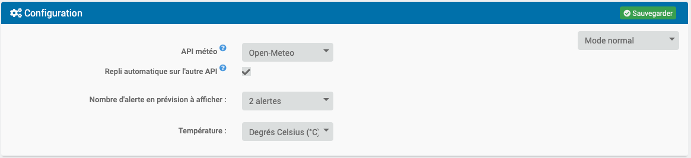
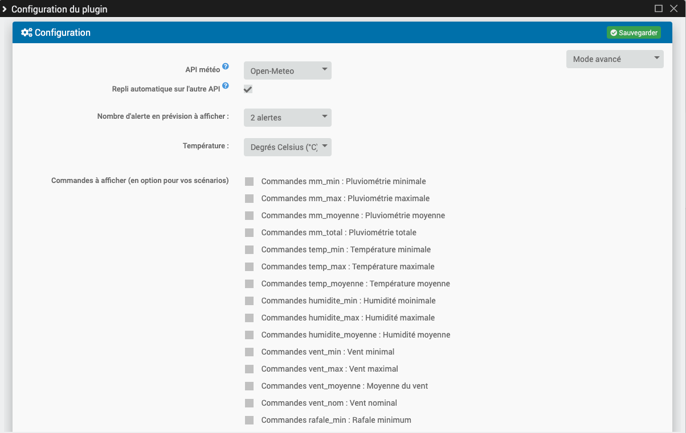
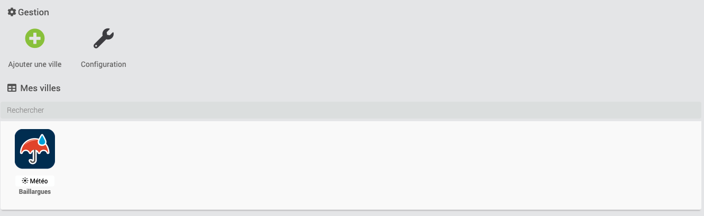
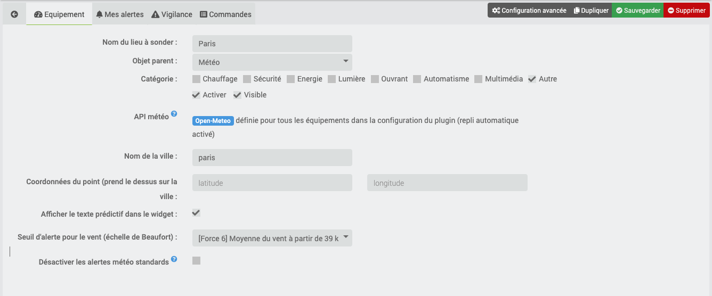
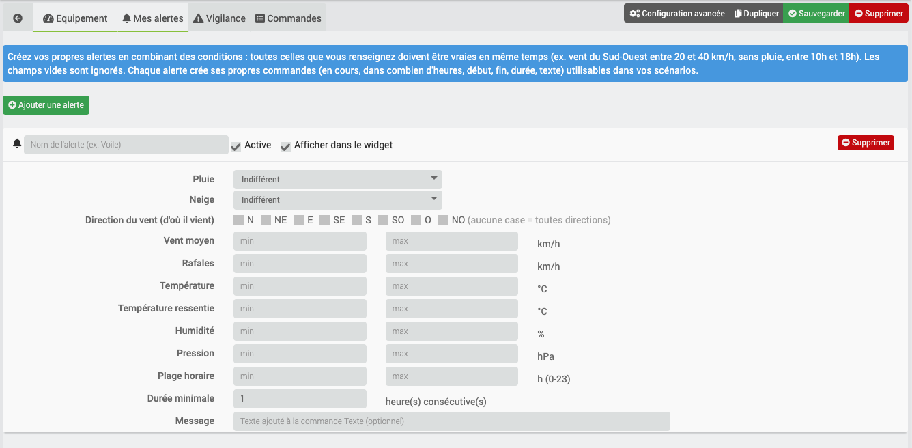
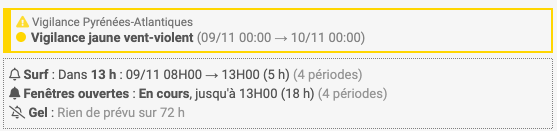
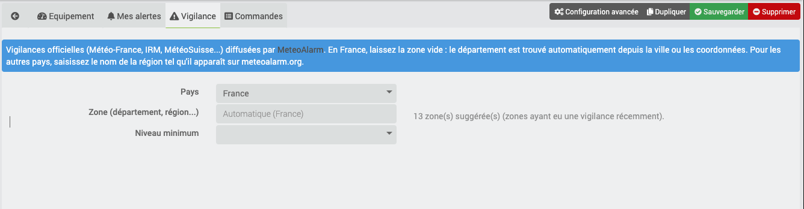
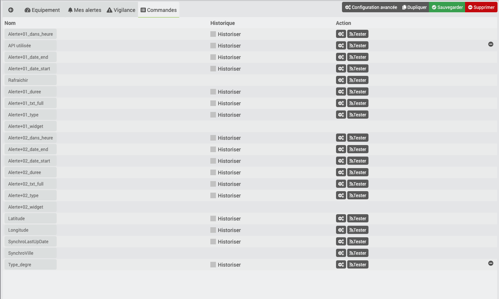

[English version available here](docs/en_US/index.md)

Description
===

Ce plugin annonce les prochaines alertes (72H) météo, partout dans le monde avec Open-Meteo ou en France, Belgique et Suisse avec prevision-meteo.ch. Previsy construit également des phrases qui peuvent être utilisées pour vous être envoyées par sms, annoncées par votre home ou slack etc...

Vous pouvez aussi créer vos propres alertes en combinant des conditions (pluie, vent, direction, température, humidité, pression, plage horaire...) et recevoir les vigilances officielles (Météo-France, IRM, MétéoSuisse...). Le widget est disponible sur le dashboard et dans l'application mobile.

## Exemples d'utilisation

### Alertes de la vie courante

> Vous souhaitez savoir ou étendre le linge ? Prévisy vous annoncera que la prochaine pluie est dans 14H et il y aura un peu de vent cela vaut le coup de l'étendre dehors.

> Vous venez d'ouvrir un vélux ? Prévisy vous annoncera les prochaines précipitation pour penser à la fermer ou vous aider à paramétrer automatiquement une alerte une heure avant la pluie.

### Indicateurs pour les sportifs

> Après-demain dans 31H, Previsy vous annonce une bonne brise. Idéal pour sortie la planche à voile !

> Passionné de surf, vous attendez la prochaine poudreuse ? Previsy vous annonce que la neige s'arrête de tomber ce week-end, ça tombe plutôt bien !

Comme vous pouvez le voir, les prévisions peuvent vous aider sur pas mal de points.

## Deux manières d'utiliser Previsy

### Avec le widget et les phrases préconstruites.

Le widget est disponible sur le dashboard et dans l'application mobile.

### En utilisant directement les données brutes

Vous pourrez, bien évidemment, récupérer les données brutes pour créer vos scénarios et ainsi les associer à des services (SMS, Slack, Notification, etc.)

Installation
===

## Choix de l'API météo

Previsy peut utiliser l'une des API suivantes :

| API | Couverture | Clé API |
| --- | --- | --- |
| [Open-Meteo](https://open-meteo.com) | Monde entier | Non |
| [prevision-meteo.ch](https://www.prevision-meteo.ch) | France, Belgique, Suisse | Non |

Le choix se fait dans la **configuration du plugin** (champ « API météo ») :
- **Open-Meteo** ou **prevision-meteo.ch** : tous les équipements utilisent cette API. Changer ce réglage bascule tous les équipements d'un coup ;
- **Choix par équipement** : chaque équipement choisit son API dans sa fiche.

### Quelle API choisir ?

**Open-Meteo est recommandé** (c'est le réglage d'une nouvelle installation) :
- il couvre le monde entier et trouve n'importe quelle commune, alors que prevision-meteo.ch ne connaît que sa propre liste de villes ;
- il est plus disponible : prevision-meteo.ch est régulièrement saturé ;
- il fournit toutes les données utilisées par les alertes personnalisées (vent, rafales, direction, température ressentie, humidité, pression...).

Avec Open-Meteo, la ville est retrouvée automatiquement (géocodage). Si plusieurs communes portent le même nom (ex. Saint-Denis), renseignez plutôt les coordonnées, qui restent prioritaires.

### Repli automatique en cas d'indisponibilité

Avec l'option **Repli automatique sur l'autre API** (activée par défaut), si l'API choisie ne répond pas (panne, saturation, quota dépassé), Previsy récupère les prévisions auprès de l'autre API. Dans ce cas :
- un **warning** est écrit dans les logs du plugin à chaque tentative ;
- un **message** est ajouté au centre de messages de Jeedom (une seule fois, tant que l'API reste indisponible) ;
- le widget affiche « *API* indisponible : données *autre API* » et la commande **API utilisée** indique « (repli) » ;
- l'API choisie est retentée à chaque mise à jour (toutes les heures). Dès qu'elle répond, Previsy y revient et le message disparaît.

Si l'autre API ne trouve pas le lieu (par exemple une ville absente de la liste de prevision-meteo.ch), le repli n'est pas utilisé et les dernières données en cache sont conservées. Pour un repli fiable, renseignez des coordonnées : les deux API les acceptent.

Une erreur de configuration (ville introuvable sur l'API choisie) ne déclenche pas de repli : elle s'affiche dans le widget pour que vous puissiez la corriger.

### Après une mise à jour du plugin

Lors de la mise à jour, le plugin passe en **Choix par équipement** et les équipements existants **restent sur prevision-meteo.ch** : leur comportement ne change pas. Pour tout passer sur Open-Meteo :
1. dans la configuration du plugin, choisissez « Open-Meteo » dans **API météo** et sauvegardez ;
2. les prévisions de chaque équipement sont rechargées à la prochaine mise à jour (au plus une heure), ou immédiatement avec la commande Rafraichir ;
3. vérifiez dans les commandes (ou le widget) que le lieu et les alertes vous conviennent.

> Les deux API ne décrivent pas le temps exactement de la même façon : après le changement, une même situation peut produire des alertes un peu différentes (par exemple une bruine annoncée comme « Pluie faible »). Pensez à vérifier les scénarios qui utilisent les commandes de Previsy.

### Cache

Previsy enregistre les données de l'API en cache (2 heures) et s'en sert pour réactualiser les widgets si l'API est indisponible ou trop longue à répondre. Le cache est rechargé automatiquement si vous changez d'API ou de lieu.

## Configuration

### Nombre d'alerte en prévision à afficher

Cela permet de configurer le nombre d'alertes que vous souhaitez afficher. 

**Exemple**
> "Vous souhaitez afficher uniquement les 2 prochaines alertes."*

### Température
Vous avez la possibilité d'afficher les températures en degrés Celsius (°C) ou en degrés Fahrenheit (°F)

### Commandes à afficher (en option pour vos scénarios)
Les données vous permettant de créer vos scénarios sur mesure. Il vous suffit de cocher les commandes que vous souhaitez voir apparaitre. Vous n'aurez probablement pas besoin de tout utiliser. (toutes les commandes seront décrites par la suite). 

Cette liste n'apparaît qu'en mode **avancé** ou **debug** (liste déroulante en haut à droite de la configuration du plugin).

**Attention**
> Si vous voulez afficher 5 alertes et toutes les commandes vous allez en avoir beaucoup ! 

### API météo
L'API utilisée par tous les équipements (Open-Meteo, prevision-meteo.ch), ou « Choix par équipement ». Voir la section « Choix de l'API météo ».

### Repli automatique sur l'autre API
Si l'API choisie est indisponible, Previsy utilise l'autre API et vous prévient (logs, centre de messages, widget). Voir la section « Choix de l'API météo ».

### Tâche planifiée
Si vous désactivez la tâche planifiée qui à lieu toutes les heures ... le plugin ne servira plus à rien ...

Gestion
===

Le bouton **Debug** n'apparaît qu'en mode debug (liste déroulante en haut à droite de la configuration du plugin).

## Equipement

### API météo
Ce champ n'apparaît qu'en mode « Choix par équipement » (configuration du plugin) : Open-Meteo (recommandé) ou prevision-meteo.ch. Sinon, l'API définie pour tous les équipements est simplement rappelée.

### Ville
Ici on entre le nom de la ville que vous désirez sonder. La saisie est automatiquement mise en minuscules et sans accents (ex. « Le Havre » devient « le-havre »).

- **Open-Meteo** : la ville est retrouvée automatiquement. En cas d'homonymes, utilisez les coordonnées.
- **prevision-meteo.ch** : un bouton s'affiche à droite de la saisie pour tester la ville directement sur le site. Si le site est hors ligne ou met du temps à répondre, il faudra retenter plus tard.

> Dans l'url de prevision-meteo.ch, le mot-clé de la ville : https://www.prevision-meteo.ch/meteo/localite/votreville

### Coordonnées du point

Renseignez la latitude et la longitude de l'endroit que vous désirez sonder, en degrés décimaux (ex. 48.39 et -4.49 pour Brest : les longitudes à l'ouest de Greenwich et les latitudes de l'hémisphère sud sont négatives). Si vous renseignez des coordonnées, la ville ne sera pas prise en compte.

> Pour tester sur prevision-meteo.ch : https://www.prevision-meteo.ch/meteo/localite/lat=48.390lng=-4.490

### Afficher le texte prédictif dans le widget 

Cela permet d'afficher le texte prédictif dans le widget.

### Seuil d'alerte pour le vent

Vous pouvez régler le seuil du vent suivant la localité. L'alerte "vent" ne se déclenchera pas en dessous de ce seuil. Choisissez « Aucune alerte liée au vent » pour ne pas en recevoir.

### Désactiver les alertes météo standards

Cochez cette case pour ne plus recevoir les alertes standards (pluie, neige, orage, brouillard). Utile si vous n'utilisez que vos propres alertes ou la vigilance.

## Mes alertes (alertes personnalisées)

Dans l'onglet **Mes alertes**, créez autant d'alertes que vous voulez (20 au maximum par équipement). Une alerte se déclenche sur les heures où **toutes les conditions renseignées** sont vraies ; les champs laissés vides sont ignorés.

| Condition | Description |
| --- | --- |
| Pluie / Neige | Indifférent, Oui (il pleut / il neige) ou Non (il ne pleut pas / il ne neige pas) |
| Direction du vent | Une ou plusieurs directions d'où vient le vent (N, NE, E, SE, S, SO, O, NO). Aucune case cochée = toutes |
| Vent moyen, rafales | Valeurs minimum et/ou maximum en km/h |
| Température, température ressentie | Valeurs minimum et/ou maximum |
| Humidité, pression | Valeurs minimum et/ou maximum (% et hPa) |
| Plage horaire | Heures de début et de fin (0 à 23). Une plage 22 → 6 passe minuit |
| Durée minimale | Nombre d'heures consécutives nécessaires pour retenir une période |

Exemples :
- **Voile** : pas de pluie, vent entre 20 et 40 km/h venant de l'Ouest ou du Sud-Ouest, entre 10h et 18h, pendant au moins 3 heures.
- **Gel** : température maximum 0 °C.
- **Arrosage inutile** : pluie = Oui, pendant au moins 2 heures.

Chaque alerte crée ses propres commandes, nommées d'après l'alerte (ex. « Voile - En cours ») :

| Type | Commande | Description |
| --- | --- | --- |
| info binaire | *Nom* - En cours | 1 si la période a commencé |
| info numérique | *Nom* - Dans (heures) | Nombre d'heures avant la prochaine période |
| info numérique | *Nom* - Début / Fin | Début et fin de la prochaine période (format AAAAMMJJHHMM) |
| info numérique | *Nom* - Durée | Durée de la prochaine période en heures |
| info numérique | *Nom* - Nombre de périodes | Nombre de périodes trouvées sur 72 heures |
| info texte | *Nom* - Texte | Phrase prête à envoyer, suivie de votre message |

Dans le widget, chaque alerte occupe une ligne : à venir (« Dans 13 h : 09/11 08H00 → 13H00 »), en cours (« En cours, jusqu'à 13H00 ») ou rien de prévu sur 72 heures. Le survol d'une ligne affiche la phrase complète avec votre message.

Vous pouvez désactiver les alertes standards (pluie, neige, orage, brouillard) dans l'onglet Equipement, et choisir « Aucune alerte liée au vent », pour ne garder que vos propres alertes.

## Vigilance météo nationale

Dans l'onglet **Vigilance**, Previsy peut remonter les vigilances officielles (Météo-France, IRM, MétéoSuisse...) diffusées par [MeteoAlarm](https://meteoalarm.org), sans clé API : vent violent, pluie-inondation, inondation, orages, neige-verglas, canicule, grand froid, avalanches, vagues-submersion...

- **Pays** : France, Belgique, Suisse, Luxembourg et d'autres pays européens.
- **Zone** : en France, laissez vide, le département est trouvé automatiquement depuis la ville ou les coordonnées. Ailleurs, saisissez le nom de la région tel qu'il apparaît sur meteoalarm.org. Le champ propose les zones présentes dans le flux du pays : seules celles ayant eu une vigilance récemment y figurent, la liste peut donc être incomplète (voire vide).
- **Niveau minimum** : jaune, orange ou rouge.

La vigilance s'affiche en bandeau en haut du widget (voir l'image de la section précédente) : le cadre prend la couleur du niveau le plus élevé, et chaque phénomène est listé avec sa période. Le survol affiche la description officielle. Le bandeau n'apparaît que s'il y a une vigilance en cours ou annoncée.

La vigilance est aussi disponible dans les commandes suivantes :

| Type | Commande | Description |
| --- | --- | --- |
| info numérique | Vigilance niveau | 0 = aucune, 2 = jaune, 3 = orange, 4 = rouge (historisée) |
| info texte | Vigilance couleur | aucune, jaune, orange ou rouge (en anglais si Jeedom est en anglais : none, yellow, orange, red) |
| info binaire | Vigilance en cours | 1 si la vigilance a commencé (0 si elle est seulement annoncée) |
| info texte | Vigilance texte | Ex. « Vigilance orange pluie-inondation (Gard) jusqu'au 05/11/2026 00:00. » |
| info texte | Vigilance zone | Zone utilisée (département détecté ou saisi) |
| info numérique | Vigilance début / fin | Période couverte (format AAAAMMJJHHMM) |

## Commandes

> Le nombre de commandes sera forcément proportionnel au nombre d'alerte que vous avez configurée.

### Les commandes générales

| Type | Commande | Description |
| ------------ | ------------ | ------------ | 
| info | SynchroVille | Cela correspond à la ville que vous avez enregistrée. |
| info | SynchroLastUpDate | Date au format "timestamp" de la dernière synchronisation avec l'API météo. | 
| info | Latitude | Comme son nom l'indique | 
| info | Longitude | Comme son nom l'indique | 
| info | Type_degre | °C ou °F | 
| info | API utilisée | API qui a fourni les dernières prévisions, suivie de « (repli) » si l'API choisie était indisponible. | 
| action | Rafraichir | La fameuse commande permettant de rafraîchir le widget. Elle recharge les prévisions depuis l'API météo choisie, au plus une fois toutes les 5 minutes (au-delà, le cache est utilisé). | 

### Les commandes liées aux alertes

> Les commandes qui suivent sont liées à l'alerte 1 identifié par le "01". Plus il y a d'alerte plus il y aura de commande.

| Type | Commande | Description |
| ------------ | ------------ | ------------ |
| info | Alerte+01_txt_full | C'est la phrase complète. Elle comporte toutes les indications liées à la météo. Exemple : "Dans 18 heures, soit demain à partir de 16 heures, il va pleuvoir durant 1 heure. Il y aura un total de 0.3 millimètre de précipitation. Le taux d'humidité sera de 99.0%. La température sera de 10.5°C. Le vent soufflera en moyenne à 24.0 KM/H avec des rafales pouvant aller jusqu'à 38.0 KM/H." |  
| info | Alerte+01_txt_start | C'est la première partie de la phrase. Exemple : "Dans 18 heures, soit demain à partir de 16 heures, il va pleuvoir durant 1 heure." | 
| info | Alerte+01_txt_mm | C'est la partie de la phrase liée à la précipitation. Exemple : "Il y aura un total de 0.3 millimètre de précipitation." | 
| info | Alerte+01_txt_humidite  | C'est la partie de la phrase liée à l'humidité. Exemple : "Le taux d'humidité sera de 99.0%." | 
| info | Alerte+01_txt_temperature | C'est la partie de la phrase liée à la température. Exemple : "La température sera de 10.5°C." | 
| info | Alerte+01_txt_vent | C'est la partie de la phrase liée au vent. Exemple : "Le vent soufflera en moyenne à 24.0 KM/H avec des rafales pouvant aller jusqu'à 38.0 KM/H." | 

> Vous l'aurez compris, cela vous permettra de reconstruire vos phrases comme vous le souhaitez !

| Type | Commande | Description |
| ------------ | ------------ | ------------ | 
| info | Alerte+01_dans_heure | Prochaine alerte en heure. |
| info | Alerte+01_date_start | Date de début de la prochaine alerte au format YmdHi. | 
| info | Alerte+01_date_end | Date de fin de la prochaine alerte au format YmdHi. | 
| info | Alerte+01_type | Type d'alerte (pluie, neige, neige_pluie, orage, brouillard ou vent). | 
| info | Alerte+01_condition_max | Description de l'alerte au plus haut. | 
| info | Alerte+01_duree | Durée de l'alerte (du même type et successif). | 
| info | Alerte+01_mm_min | Précipitation Minimum. |
| info | Alerte+01_mm_max | Précipitation Maximum. | 
| info | Alerte+01_mm_moyenne | Moyenne des Précipitations. | 
| info | Alerte+01_mm_total | Total des Précipitations. | 
| info | Alerte+01_temp_min | Température Minimum. | 
| info | Alerte+01_temp_max | Température Maximum. | 
| info | Alerte+01_temp_moyenne | Moyenne des Températures. | 
| info | Alerte+01_humidite_min | Taux d'Humidité Minimum. | 
| info | Alerte+01_humidite_max | Taux d'Humidité Maximum. | 
| info | Alerte+01_humidite_moyenne | Moyenne du Taux d'Humidité. | 
| info | Alerte+01_vent_min | Vitesse Minimum du Vent. | 
| info | Alerte+01_vent_max | Vitesse Maximum du Vent. | 
| info | Alerte+01_vent_moyenne | Moyenne de la Vitesse du Vent. | 
| info | Alerte+01_rafale_min | Vitesse Minimum des rafales. | 
| info | Alerte+01_rafale_max | Vitesse Maximum des rafales. | 
| info | Alerte+01_rafale_moyenne | Moyenne de la Vitesse des rafales. | 
