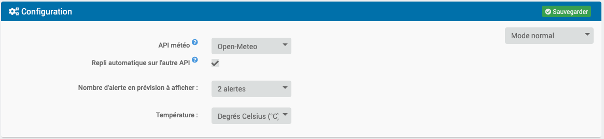
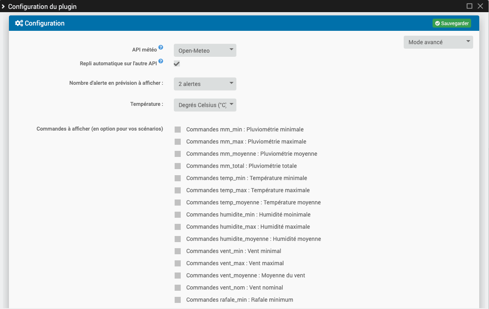
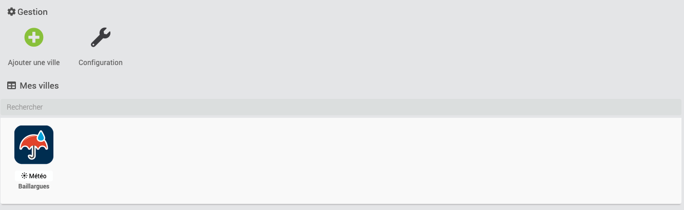
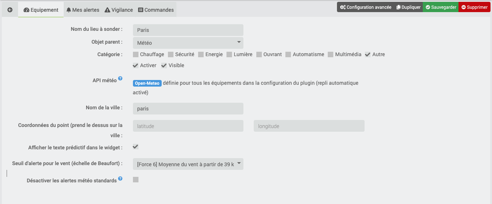
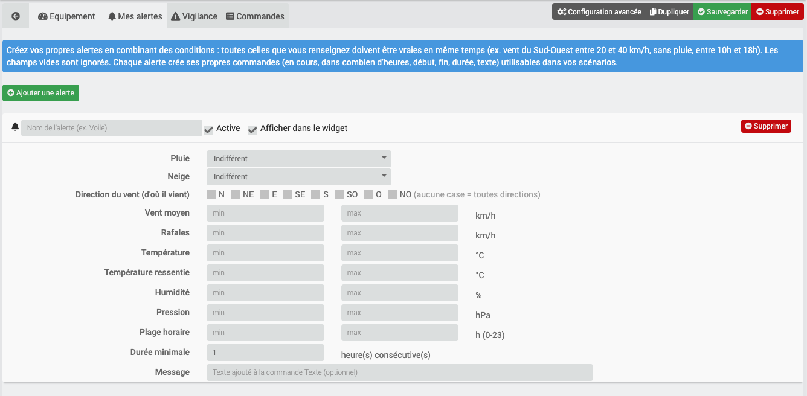
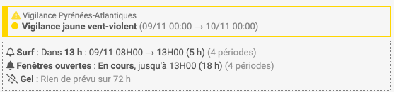
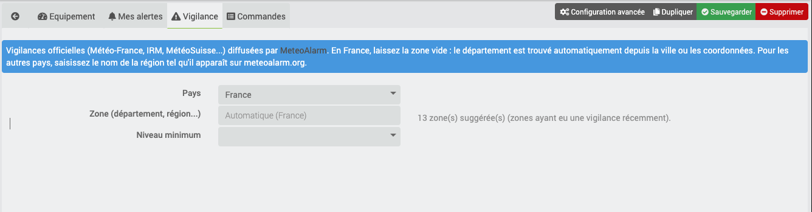
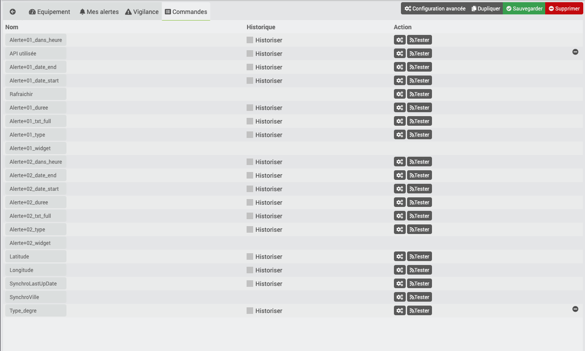

Description
===

This plugin announces the next weather alerts (72H), worldwide with Open-Meteo or in France, Belgium and Switzerland with prevision-meteo.ch. Previsy also builds sentences that can be used to be sent to you by sms, announced by your home or slack etc...

You can also create your own alerts by combining conditions (rain, wind, direction, temperature, humidity, pressure, time range...) and receive the official weather warnings (Météo-France, RMI, MeteoSwiss...). The widget is available on the dashboard and in the mobile app.

## Examples of use

### Everyday life alerts

> You wish to know where to hang the laundry? Prévisy will announce you that the next rain is in 14H and there will be a little wind it's worth to hang it outside.

> Have you just opened a velux? Prévisy will announce the next rainfall to think about closing it or help you to automatically set an alert one hour before the rain.

### Indicators for athletes

> The day after tomorrow in 31H, Previsy announces you a good breeze. Ideal for windsurfing !

> Passionate about snowboarding, are you waiting for the next snowfall? Previsy tells you that the snow stops falling this weekend, it's coming down pretty well!

As you can see, forecasts can help you in many ways.

## Two ways to use Previsy

### With the widget and prebuilt sentences.

The widget is available on the dashboard and in the mobile app.

### Using the raw data directly

You will, of course, be able to retrieve the raw data to create your scenarios and associate them with services (SMS, Slack, Notification, etc.).

Installation
===

## Choosing the weather API

Previsy can use one of the following APIs:

| API | Coverage | API key |
| --- | --- | --- |
| [Open-Meteo](https://open-meteo.com) | Worldwide | No |
| [prevision-meteo.ch](https://www.prevision-meteo.ch) | France, Belgium, Switzerland | No |

The choice is made in the **plugin configuration** ("Weather API" field):
- **Open-Meteo** or **prevision-meteo.ch**: all equipments use this API. Changing this setting switches all equipments at once;
- **Choice per equipment**: each equipment chooses its API in its own page.

### Which API should I choose?

**Open-Meteo is recommended** (it is the setting of a new installation):
- it covers the whole world and finds any town, while prevision-meteo.ch only knows its own list of cities;
- it is more available: prevision-meteo.ch is regularly saturated;
- it provides all the data used by custom alerts (wind, gusts, direction, feels-like temperature, humidity, pressure...).

With Open-Meteo, the city is found automatically (geocoding). If several towns share the same name, fill in the coordinates instead: they always take precedence.

### Automatic fallback when an API is unavailable

With the **Automatic fallback to the other API** option (enabled by default), if the chosen API does not respond (outage, saturation, quota exceeded), Previsy gets the forecast from the other API. In that case:
- a **warning** is written in the plugin logs at each attempt;
- a **message** is added to the Jeedom message center (only once, as long as the API stays unavailable);
- the widget displays "*API* unavailable: *other API* data" and the **API utilisée** command shows "(repli)";
- the chosen API is tried again at each update (every hour). As soon as it responds, Previsy goes back to it and the message disappears.

If the other API cannot find the location (for example a city missing from the prevision-meteo.ch list), the fallback is not used and the last cached data is kept. For a reliable fallback, fill in coordinates: both APIs accept them.

A configuration error (city not found on the chosen API) does not trigger a fallback: it is displayed in the widget so that you can fix it.

### After updating the plugin

When updating, the plugin switches to **Choice per equipment** and existing equipments **stay on prevision-meteo.ch**: their behaviour does not change. To switch everything to Open-Meteo:
1. in the plugin configuration, choose "Open-Meteo" in **Weather API** and save;
2. each equipment's forecast is reloaded at the next update (within one hour), or immediately with the Rafraichir command;
3. check in the commands (or the widget) that the location and the alerts suit you.

> Both APIs do not describe the weather in exactly the same way: after switching, the same situation may produce slightly different alerts (for example drizzle reported as "light rain"). Remember to check the scenarios that use Previsy commands.

### Cache

Previsy caches the API data (2 hours) and uses it to refresh the widgets if the API is unavailable or too long to respond. The cache is reloaded automatically when you change the API or the location.

## Configuration

### Number of alerts expected to be displayed

This allows you to configure the number of alerts you wish to display. 

**Exemple**
> "You wish to display only the next 2 alerts."

### Temperature
You can display temperatures in degrees Celsius (°C) or Fahrenheit (°F).

### Commands to display (optional for your scenarios)
Data allowing you to create your custom scenarios. You just have to check the commands you wish to see appear. You probably won't need to use all of them. (all commands will be described later). 

This list only appears in **advanced** or **debug** mode (drop-down list at the top right of the plugin configuration).

**Warning**
> If you want to display 5 alerts and all the commands you will get a lot of them! 

### Weather API
The API used by all equipments (Open-Meteo, prevision-meteo.ch), or "Choice per equipment". See the "Choosing the weather API" section.

### Automatic fallback to the other API
If the chosen API is unavailable, Previsy uses the other API and warns you (logs, message center, widget). See the "Choosing the weather API" section.

### Scheduled task (cron)
If you disable the scheduled task that takes place every hour ... the plugin will be useless ...

Management
===

The **Debug** button only appears in debug mode (drop-down list at the top right of the plugin configuration).

## Equipment

### Weather API
This field only appears in "Choice per equipment" mode (plugin configuration): Open-Meteo (recommended) or prevision-meteo.ch. Otherwise, the API defined for all equipments is simply shown.

### City
Here you enter the name of the city you wish to survey. The input is automatically converted to lower case without accents (e.g. "Le Havre" becomes "le-havre").

- **Open-Meteo**: the city is found automatically. If several towns share the same name, use the coordinates.
- **prevision-meteo.ch**: a button is displayed on the right of the entry to test the city directly on the website. If the site is offline or takes a long time to answer, you will have to try again later.

> In the prevision-meteo.ch url, the keyword of the city: https://www.prevision-meteo.ch/meteo/localite/yourcity

### Coordinates of the localisation

Fill in the latitude and longitude of the location you wish to survey, in decimal degrees (e.g. 48.39 and -4.49 for Brest: longitudes west of Greenwich and latitudes of the southern hemisphere are negative). If you enter coordinates, the city will not be taken into account.

> To test on prevision-meteo.ch: https://www.prevision-meteo.ch/meteo/localite/lat=48.390lng=-4.490

### Display predictive text in the widget

This allows to display the predictive text in the widget.
Weather warnings (rain, snow, etc...) have priority over wind warnings.

### Wind alert threshold

You can set the wind threshold according to the locality. The "wind" alert will not be triggered below this threshold. Choose "No wind alert" to never receive it.

### Disable standard weather alerts

Tick this box to stop receiving the standard alerts (rain, snow, thunderstorm, fog). Useful if you only use your own alerts or the weather warnings.

## My alerts (custom alerts)

In the **My alerts** tab, create as many alerts as you want (up to 20 per equipment). An alert is triggered on the hours when **all the conditions you filled in** are true; empty fields are ignored.

| Condition | Description |
| --- | --- |
| Rain / Snow | Any, Yes (it rains / it snows) or No (it does not rain / it does not snow) |
| Wind direction | One or more directions the wind comes from (N, NE, E, SE, S, SO = SW, O = W, NO = NW). No box ticked = all |
| Average wind, gusts | Minimum and/or maximum values in km/h |
| Temperature, feels-like temperature | Minimum and/or maximum values |
| Humidity, pressure | Minimum and/or maximum values (% and hPa) |
| Time range | Start and end hours (0 to 23). A 22 → 6 range goes past midnight |
| Minimum duration | Number of consecutive hours required to keep a period |

Examples:
- **Sailing**: no rain, wind between 20 and 40 km/h from the West or South-West, between 10am and 6pm, for at least 3 hours.
- **Frost**: maximum temperature 0 °C.
- **No need to water**: rain = Yes, for at least 2 hours.

Each alert creates its own commands, named after the alert (e.g. "Sailing - In progress"):

| Type | Command | Description |
| --- | --- | --- |
| binary info | *Name* - In progress | 1 if the period has started |
| numeric info | *Name* - In (hours) | Number of hours before the next period |
| numeric info | *Name* - Start / End | Start and end of the next period (YYYYMMDDHHMM format) |
| numeric info | *Name* - Duration | Duration of the next period in hours |
| numeric info | *Name* - Number of periods | Number of periods found within 72 hours |
| string info | *Name* - Text | Ready-to-send sentence, followed by your message |

In the widget, each alert takes one line: upcoming ("Dans 13 h : 09/11 08H00 → 13H00"), in progress ("En cours, jusqu'à 13H00") or nothing expected within 72 hours. Hovering over a line shows the full sentence with your message.

## National weather warnings

In the **Warning** tab, Previsy can report the official weather warnings (Météo-France, RMI, MeteoSwiss...) published by [MeteoAlarm](https://meteoalarm.org), without API key: violent wind, rain-flood, flooding, thunderstorms, snow-ice, heat wave, extreme cold, avalanches, waves-submersion...

- **Country**: France, Belgium, Switzerland, Luxembourg and other European countries.
- **Area**: in France, leave it empty, the department is found automatically from the city or the coordinates. Elsewhere, enter the region name as shown on meteoalarm.org. The field suggests the areas found in the country's feed: only areas that recently had a warning are listed, so the list may be incomplete (or empty).
- **Minimum level**: yellow, orange or red.

The warning is displayed as a banner at the top of the widget (see the picture in the previous section): the frame takes the colour of the highest level, and each phenomenon is listed with its period. Hovering shows the official description. The banner only appears when a warning is in progress or announced.

The warning is also available in the following commands:

| Type | Command | Description |
| --- | --- | --- |
| numeric info | Warning level | 0 = none, 2 = yellow, 3 = orange, 4 = red (historized) |
| string info | Warning colour | none, yellow, orange or red (in French if Jeedom is in French: aucune, jaune, orange, rouge) |
| binary info | Warning in progress | 1 if the warning has started (0 if it is only announced) |
| string info | Warning text | E.g. "Vigilance orange pluie-inondation (Gard) jusqu'au 05/11/2026 00:00." |
| string info | Warning area | Area used (detected or entered department) |
| numeric info | Warning start / end | Period covered (YYYYMMDDHHMM format) |

## Controls

> The number of orders will necessarily be proportional to the number of alerts you have configured.

### General controls

| Type | Control | Description |
| ------------ | ------------ | ------------ | 
| info | SynchroVille | This corresponds to the city you have registered. |
| info | SynchroLastUpDate | Date in "timestamp" format of the last synchronization with the weather API. | 
| info | Latitude | As its name indicates | 
| info | Longitude | As its name indicates | 
| info | Type_degre | °C ou °F | 
| info | API utilisée | API that provided the latest forecast, followed by "(repli)" if the chosen API was unavailable. | 
| action | Rafraichir | The famous command to refresh the widget. It reloads the forecast from the chosen weather API, at most once every 5 minutes (otherwise the cache is used). | 

### Controls related to alerts

> The following commands are linked to alert 1 identified by the "01". The more alerts there are, the more commands there will be.

| Type | Controls | Description |
| ------------ | ------------ | ------------ |
| info | Alerte+01_txt_full | This is the complete sentence. It includes all the indications related to the weather. Example: "In 18 hours, that is to say tomorrow from 4 p.m., it will rain for 1 hour. There will be a total of 0.3 millimeters of precipitation. The humidity level will be 99.0%. The temperature will be 10.5°C. The wind will blow on average at 24.0 km/hr with gusts up to 38.0 km/hr." |  
| info | Alerte+01_txt_start | This is the first part of the sentence. Example: "In 18 hours, tomorrow from 4pm, it's going to rain for 1 hour." | 
| info | Alerte+01_txt_mm | This is the part of the sentence related to precipitation. Example: "There will be a total of 0.3 millimeters of precipitation." | 
| info | Alerte+01_txt_humidite  | This is the part of the sentence related to moisture. Example: "The moisture content will be 99.0%." | 
| info | Alerte+01_txt_temperature | This is the part of the sentence related to temperature. Example: "The temperature will be 10.5°C." | 
| info | Alerte+01_txt_vent | This is the part of the sentence related to the wind. Example: "The wind will blow at an average of 24.0 km/h with gusts up to 38.0 km/h". | 

> VYou will have understood it, it will allow you to compose your sentences as you wish!

| Type | Controls | Description |
| ------------ | ------------ | ------------ | 
| info | Alerte+01_dans_heure | Next alert in time. |
| info | Alerte+01_date_start | Start date of the next alert in YmdHi format. | 
| info | Alerte+01_date_end | End date of the next alert in YmdHi format. | 
| info | Alerte+01_type | Type of alert (rain, snow, snow_rain, thunderstorm, fog or wind). | 
| info | Alerte+01_condition_max | Description of the Highest Alert. | 
| info | Alerte+01_duree | Duration of the alert (of the same type and successive). | 
| info | Alerte+01_mm_min | Minimum rainfall |
| info | Alerte+01_mm_max | Maximum rainfall. | 
| info | Alerte+01_mm_moyenne | Average rainfall. | 
| info | Alerte+01_mm_total | Total rainfall. | 
| info | Alerte+01_temp_min | Minimum temperature. | 
| info | Alerte+01_temp_max | Maximum temperature. | 
| info | Alerte+01_temp_moyenne | Average temperature. | 
| info | Alerte+01_humidite_min | Minimum humidity. | 
| info | Alerte+01_humidite_max | Maximum humidity. | 
| info | Alerte+01_humidite_moyenne | Average humidity. | 
| info | Alerte+01_vent_min | Minimum wind speed. | 
| info | Alerte+01_vent_max | Maximum wind speed. | 
| info | Alerte+01_vent_moyenne | Average wind speed. | 
| info | Alerte+01_rafale_min | Minimum gust speed. | 
| info | Alerte+01_rafale_max | Maximum gust speed. | 
| info | Alerte+01_rafale_moyenne | Average gust speed. | 